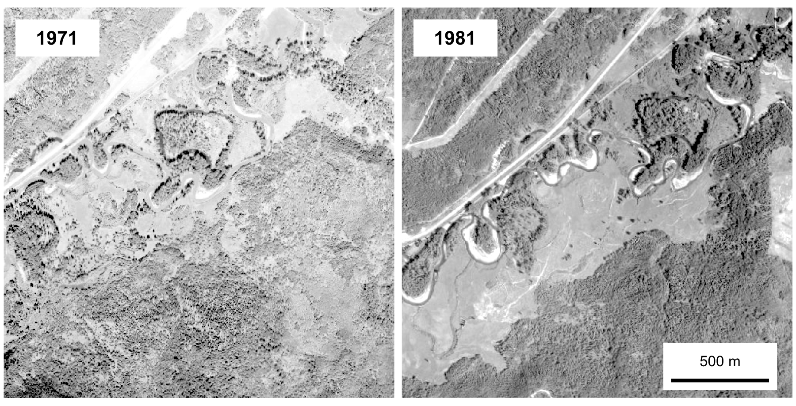

# fly 

<!-- badges: start -->
[](https://lifecycle.r-lib.org/articles/stages.html#experimental)
[](https://github.com/NewGraphEnvironment/fly/actions/workflows/R-CMD-check.yaml)
<!-- badges: end -->

> Footprints, selection and georeferencing for British Columbia's historic airphotos.

fly helps you find and use British Columbia's historic airphotos. The province's catalogue records
where each photo was taken, but not the ground it shows. fly works that out, finds the photos over
your study area, picks a small set that covers as much of it as you need, and can download the
scans and place them on a map.

Older photos often show a site before roads, farming and logging changed it. That makes them a
reference for what to restore toward, and a baseline for measuring change.

With an elevation model, fly allows for the height of the land under the aircraft, which makes the
footprints of film photos more accurate, and it corrects known errors in the catalogue's flying
heights.



*The upper Bulkley River (Neexdzii Kwa) at McKilligan Road near Houston, BC, in
[1971](https://images.a11s.one/collections/stac-airphoto-bc/items/1400364) and
[1981](https://images.a11s.one/collections/stac-airphoto-bc/items/790359), placed on the map by
fly. Each photo sits on its own estimated footprint, so features line up approximately rather than
exactly.*

## Installation

```r
pak::pak("NewGraphEnvironment/fly")
```

Functions still change between releases ([NEWS](https://github.com/NewGraphEnvironment/fly/blob/main/NEWS.md)),
so pin a version for repeatable work: `pak::pak("NewGraphEnvironment/fly@vX.Y.Z")`.

## Example

Twenty 1968 photos of the Upper Bulkley River floodplain near Houston, BC, ship with the package.
How much of the floodplain each scale covers, and the fewest photos that cover 80% of it:

```r
library(fly)

centroids <- sf::st_read(system.file("testdata/photo_centroids.gpkg", package = "fly"), quiet = TRUE)
aoi <- sf::st_read(system.file("testdata/aoi.gpkg", package = "fly"), quiet = TRUE)

fly_coverage(centroids, aoi, by = "scale")
#> # A tibble: 2 × 4
#>   scale   n_photos covered_km2 coverage_pct
#>   <chr>      <int>       <dbl>        <dbl>
#> 1 1:12000       10        14.8         59.5
#> 2 1:31680       10        24.8        100

selected <- fly_select(centroids, aoi, mode = "minimal", target_coverage = 0.8)
#> Selecting photos (target: 80% coverage)...
#>   3 photos -> 81.6% coverage
#> Selected 3 of 20 photos for 81.6% coverage
```

From there, `fly_fetch()` downloads the scans and `fly_georef()` writes each one as a GeoTIFF on
its footprint.

## Learn more

- [Airphoto selection pipeline](https://newgraphenvironment.github.io/fly/articles/airphoto-selection.html):
  footprints, coverage, selection and georeferencing on the bundled floodplain.
- [stac-airphoto-bc](https://www.newgraphenvironment.com/stac_airphoto_bc/): photos georeferenced
  with fly, to browse and download by place and date.
- [Method notes](https://github.com/NewGraphEnvironment/fly/tree/main/inst/notes): how footprints
  are sized from the terrain, how the catalogue's heights and camera formats are checked, and how
  scans are masked and placed.
- [Function reference](https://newgraphenvironment.github.io/fly/reference/).

## Ecosystem

| Package | Role |
|---------|------|
| [fresh](https://www.newgraphenvironment.com/fresh/) | Stream network modelling engine: segment, classify, cluster, aggregate |
| [link](https://www.newgraphenvironment.com/link/) | Intrinsic habitat models: develop, test and communicate |
| [wet](https://www.newgraphenvironment.com/wet/) | Stream flow and water temperature for BC's Freshwater Atlas |
| [flooded](https://www.newgraphenvironment.com/flooded/) | Delineate floodplain extents from DEMs and stream networks |
| [drift](https://www.newgraphenvironment.com/drift/) | Track land cover change within floodplains over time |
| [floodplains](https://www.newgraphenvironment.com/floodplains/) | Floodplain and land cover change modelling for BC watershed groups |
| [stac_floodplains_bc](https://www.newgraphenvironment.com/stac_floodplains_bc/) | STAC catalogue of floodplain land cover change in BC, 2017-2023, by watershed group |
| [cd](https://www.newgraphenvironment.com/cd/) | Climate departure analysis from ERA5-Land reanalysis |
| **fly** | Estimate airphoto footprints and select optimal coverage for a study area (this package) |
| [stac_airphoto_bc](https://www.newgraphenvironment.com/stac_airphoto_bc/) | STAC catalogue of historic BC airphotos georeferenced with fly |

Historic airphotos: fly (footprints, selection, georeferencing) &rarr; stac_airphoto_bc (published)

## Data and methods it builds on

- The province's [airphoto centroids](https://catalogue.data.gov.bc.ca/dataset/0af7544c-f2ad-4553-bb37-889c94d4c571)
  in the BC Data Catalogue, with the scans, flight logbooks, camera calibration reports and
  camera files the records link to.
- NRCan's [MRDEM-30](https://open.canada.ca/data/en/dataset/18752265-bda3-498c-a4ba-9dfe68cb98da)
  elevation model, the one the height checks were measured against.
- [GDAL](https://gdal.org/), through [sf](https://r-spatial.github.io/sf/), for warping and
  masking the scans.

## Citation

Cite fly with `citation("fly")`, or from [`CITATION.cff`](CITATION.cff).

## License

MIT © New Graph Environment Ltd.
